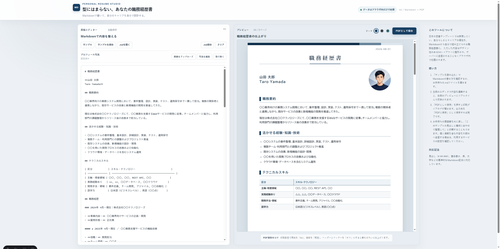

# Markdown Resume Studio

日本の定番テンプレートでは表現しにくい、自分らしさとキャリアの個性を、Markdownから組み立てられる職務経歴書に。

入力した内容は、デザイン性のあるA4レイアウトに整形されます。サーバーに送信されることなく、ブラウザ内だけで編集・プレビュー・PDF保存まで完結します。

🌐 [デモを試す](https://md-resume.jahom.dev/)



## 使い方

1. 「サンプル」でMarkdownの書き方を確認するか、「サンプルを保存」または「.mdを開く」から原稿を用意します。編集した内容があるときに別の.mdを開くと、置き換える前に確認します。
2. エディタで内容を編集すると、プレビューにリアルタイムで反映されます。画面幅が1100px以上なら左右に並び、それより狭い画面では下部のボタンで編集とプレビューを切り替えます。
3. 必要に応じてテーマ、プロフィール写真、写真の表示形状を調整します。サンプルの写真は、サンプルの名前を書き換えると表示されなくなります。
4. 「PDFとして保存」を押し、印刷ダイアログの出力先を「PDFに保存」にして保存します。初期ファイル名は「職務経歴書_氏名」のように書類名と氏名から作られます。

## 連絡先を表示する

名前の直後に、メールアドレスやプロフィールページを1行で記述すると、履歴書のタイトル下に連絡先として中央揃えで表示されます。Emailはテキストとして表示し、LinkedIn、GitHub、Portfolio、個人サイト、SNSなどのURLはMarkdownリンクとして設定できます。

```md
Phone: 090-0000-0000 · Email: your.email@example.com · [LinkedIn](https://www.linkedin.com/in/your-name/) · [GitHub](https://github.com/your-name) · [Portfolio](https://portfolio.example.com)
```

## AIで原稿を整える

すでに履歴書や職務経歴書の原稿がある場合は、AIにサンプルのMarkdownと自分の原稿を渡し、次のように依頼できます。

> このサンプルの見出しと構成に合わせて、私の職務経歴書をMarkdownとして整理してください。内容は変更せず、情報が足りない部分は「〇〇」などのプレースホルダーにしてください。

外部AIサービスに個人情報を含む原稿を送信する場合は、利用するサービスの設定と取り扱いを確認してください。

## 対応している記法

- 見出し（`#`、`##`、`###` など）
- 箇条書き、番号付きリスト
- 表
- 太字、斜体、リンク
- 段落、改行、水平線

プロジェクトの見出しは、`####` などの下位見出しを使うと、会社・職務・プロジェクトの関係を整理しやすくなります。

1ページに収まらない箇条書きと表は、自動で次のページに分割されます。表の見出し行は各ページに繰り返し表示されます。1つの段落や項目が1ページを超える場合は分割できないため、プレビューに警告が表示されます。はみ出した部分はPDFに出力されないので、原稿を分けてください。

## プライバシー

Markdownの入力内容とアップロードしたプロフィール写真はブラウザ内で処理され、外部サーバーへ送信されません。ブラウザのローカルストレージに保存された内容は、同じブラウザで再訪したときに復元されます。

重要な原稿は、必要に応じて「.md保存」から手元にも保存してください。

## 日本式の履歴書を作成する

上部の「履歴書」タブで、同じ画面のまま日本式の履歴書に切り替えられます。職務経歴書と履歴書の入力内容・配色・フォントはそれぞれ保持されます。

- 基本情報、学歴・職歴、免許・資格を入力し、A4レイアウトでプレビューできます。
- 自由記入欄は見出しの編集、追加・削除、並べ替えに対応します。
- 証明写真は専用の編集ダイアログで位置と拡大率を調整できます。
- 入力データは自動保存され、JSONでバックアップ・復元できます。PDFには選択中の書類だけが出力されます。
